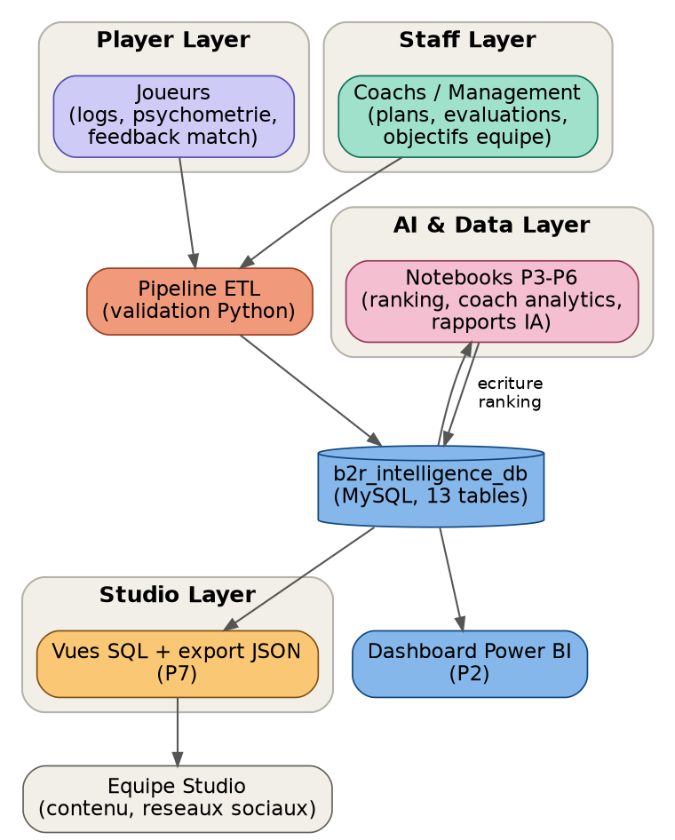
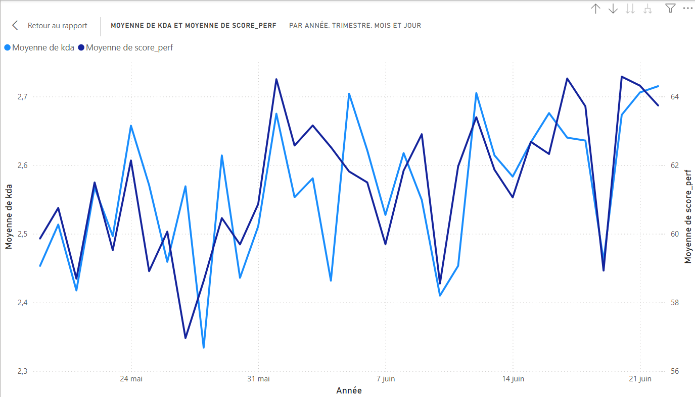
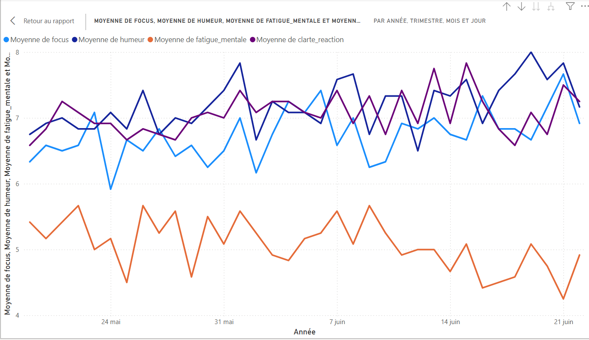
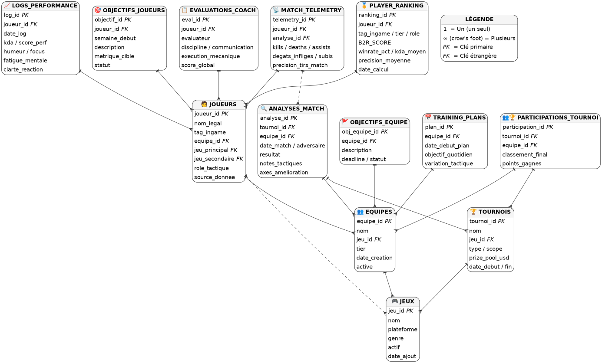

# B2R Esports Analytics Platform

**End-to-end performance analytics for a competitive gaming organisation:** MySQL database → Python ETL & analytics pipeline → Power BI dashboard → automated weekly PDF report and JSON export for the content team.

Built during my 3-month end-of-year internship (PFA, 2026) at **BACK2REVENGE STUDIO** (Morocco), as a Computer Engineering student (Big Data & AI) at Université Internationale de Rabat.


---

## The problem

The esports staff tracked players through scattered spreadsheets and gut feeling. They needed one reliable source of truth to answer three questions: **who is performing, who is at risk (fatigue, slump) and what to publish this week.**

## What I built



| # | Module | What it does | Result |
|---|---|---|---|
| P1 | **Player database + ETL** | 13-table MySQL schema; a Python validator checks every player form entry against 5 rules (duplicates, invalid tags, unknown foreign keys, future dates, date formats) | 0 % error on clean input; 5 out of 11 faulty rows caught on the test file |
| P2 | **Power BI dashboard** | 4 pages: performance, mental well-being, objectives & feedback, ranking | Delivered (Import mode) |
| P3 | **Match analysis** | Aggregates kills, damage, accuracy and deficits per match and team | 264 matches in ≈ 0.05 s (target < 5 min) |
| P4 | **Player ranking (B2R Score)** | Weighted score (40/25/20/15) using z-score + sigmoid normalisation; stability tested with **Spearman ρ** between two disjoint time windows | **ρ ≈ 0.94** (target > 0.85) |
| P5 | **Coach feedback analytics** | Keyword categorisation of coach comments, cross-tab against measured performance | ≈ 75 % of coach assessments match the data |
| P6 | **Weekly AI report** | Linear-regression forecasts and threshold-based anomaly alerts, exported as a PDF (ReportLab); alerts **backtested** against known incidents | Recall 71 %, F1 58 % (target accuracy > 90 % **not met**, see below) |
| P7 | **Studio data sync** | SQL views (top performers, player of the week, team momentum, match highlights) exported as JSON | Ready-to-use content feed |

### What didn't work, and why

The original spec asked for alert accuracy above 90 %. Incidents are a rare class (about 15 % of player-days), so a model that never raises an alert would already score about 85 % accuracy. I therefore measured recall and F1 with a backtest instead of hard-coding an accuracy number, as the first version did. The threshold detector catches 71 % of incidents. The next step is a supervised model (decision tree or gradient boosting) on the psychometric features. Details: [`docs/PROJECT_SCOPE.md`](docs/PROJECT_SCOPE.md).

## Screenshots

| Performance trend (KDA vs performance score) | Mental well-being indices |
|---|---|
|  |  |

<details>
<summary>Database schema (ERD)</summary>


</details>

## Run it yourself

The data is a **demo dataset**: 12 players over 35 days, generated by a seeded, dependency-free script. 10 players are synthetic and 2 come from the real roster but are pseudonymised. **No database is needed**: the pipeline falls back to CSV files.

```bash
pip install -r requirements.txt
python scripts/generate_dataset.py     # optional: regenerates data/ and sql/ (seed 42)
python scripts/run_pipeline.py         # runs P1 → P7, about 1 s
```

Outputs: `data/exports/` (rankings, analyses), `outputs/reports/` (weekly PDF), `outputs/studio/` (JSON feed).

To use MySQL: import `sql/00_rebuild_all.sql` in phpMyAdmin, copy `config/db.example.ini` to `config/db.ini`, run the pipeline, then import `data/exports/99_finalize_db.sql`. See [`sql/README.md`](sql/README.md).

## Repository layout

```
sql/          schema (13 tables), reference data, generated data, 4 Studio views
scripts/      generate_dataset.py · b2r_common.py (shared logic) · run_pipeline.py
notebooks/    p1 … p7 as percent-format .py (open as notebooks in VS Code/Jupyter)
data/         raw form input · generated demo data
docs/         PROJECT_SCOPE.md (scope, KPIs, limits) · LIVRABLES.md (deliverable → files)
powerbi/      dashboard documentation (the .pbix is not versioned)
```

Code comments and detailed docs are in French.

## Skills demonstrated

Relational data modelling · ETL & data validation · statistical ranking (normalisation, rank correlation) · time-series regression · anomaly detection with an honest evaluation (backtest, precision/recall/F1) · BI dashboarding · automated reporting · reproducible pipelines.

---

**Oula El-Laabi** · [GitHub](https://github.com/oulael-laabi)
